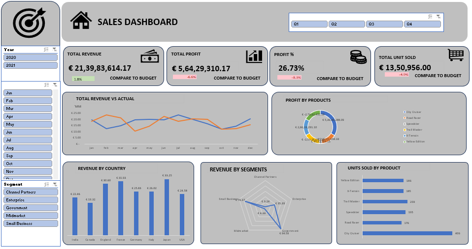

# Sales Performance Analysis & Reporting | Microsoft Excel

## Dashboard Preview

## Project Overview

This project focuses on analysing multi-year sales performance and developing an interactive Sales Dashboard and business report using Microsoft Excel.

The analysis covers revenue growth, profitability, customer segmentation, product-wise performance, country-wise revenue and budget vs actual comparisons.

The project also includes a 15-page Sales Report Presentation summarising the analysis, key findings and future business opportunities.

## Dataset Overview

- 700 sales records
- 5 customer segments
- 8 countries
- 6 products
- Sales data covering 2020 and 2021

### Key Dataset Fields
- Segment
- Country
- Product Name
- Customer ID
- Product ID
- Customer Name
- Discount Band
- Date
- Month
- Quarter
- Year
- Units Sold
- Manufacturing Price
- Sale Price
- Gross Sales
- Discounts
- Net Sales
- Cost of Goods Sold (COGS)
- Profit

## Tools & Technologies

- Microsoft Excel
- Pivot Tables
- Pivot Charts
- Excel Formulas
- Data Analysis
- Data Visualization
- Interactive Dashboard

## Analysis Performed

### 1. Sales Performance Analysis
- Revenue growth analysis
- Actual vs budget comparison
- Monthly sales trends
- Profitability analysis

### 2. Product-Wise Revenue Analysis
- Product sales contribution
- Units sold by product
- Top-performing products
- Product performance comparison

### 3. Customer Segmentation
- Enterprise
- Government
- Midmarket
- Channel Partners
- Small Business

### 4. Geographical Analysis
Revenue analysis across:
- India
- USA
- Canada
- England
- France
- Germany
- Italy
- Japan

### 5. Profitability Analysis
- Total profit
- Profit percentage
- Profit growth
- Budget variance

## Key Findings

- City Cruiser was identified as the top-selling product, accounting for 30.19% of total sales in the report.
- Profit increased by 26% compared with the previous period.
- Profit was reported as 8.3% below the budgeted target.
- Japan, France and England were identified as the leading revenue-contributing countries.
- Government and Small Business segments were highlighted as important sales contributors.

## Dashboard Features

- Total Revenue
- Total Profit
- Profit Percentage
- Total Units Sold
- Revenue vs Actual
- Profit by Products
- Revenue by Country
- Revenue by Customer Segment
- Units Sold by Product

## Business Objectives

- Understand overall sales performance.
- Identify high-performing products and customer segments.
- Compare actual revenue against budget.
- Analyse geographical sales contributions.
- Evaluate profitability and revenue growth.
- Identify opportunities for improving business performance.

## Project Files

- Sales_Data_Set_Project.xlsx
- Sales_Report_Presentation.pdf
- Dashboard Screenshot.png

## Key Learning Outcomes

- Practical experience in sales data analysis.
- Working with multi-year sales datasets.
- Building Pivot Tables and Pivot Charts.
- Analysing budget vs actual performance.
- Performing customer and product segmentation.
- Creating business reports and dashboards.
- Presenting insights for business decision-making.

## Conclusion

This project demonstrates how Microsoft Excel can be used to transform raw sales data into meaningful business insights through data analysis, visualization, financial performance reporting and interactive dashboards.

## Disclaimer

This project is intended for educational and portfolio demonstration purposes. The findings are based on the supplied project dataset and report.
